# BUD Portal

Repository for the BUD Portal app for Home Assistant, by Chill Division.

BUD (Business Utility Dashboard) keeps track of stock, chain of custody
transfers, destroyed stock and Section 29 supply records, and works out the
monthly figures for the Medicinal Cannabis Agency.

* Stock levels, with every addition and removal in each item's history, and retiring what you no longer use
* Chain of custody transfers with shipping manifests, signed for on screen or on the manifest itself
* A permanent destruction register with witness signatures
* The Section 29 register, from the pharmacies' monthly files
* Monthly materials in and out for the Agency, and who's buying what

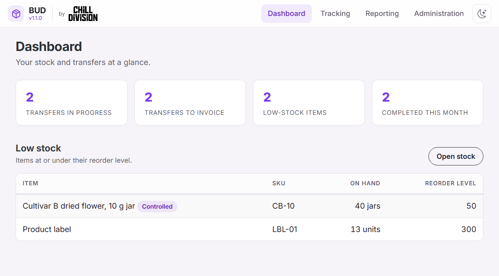 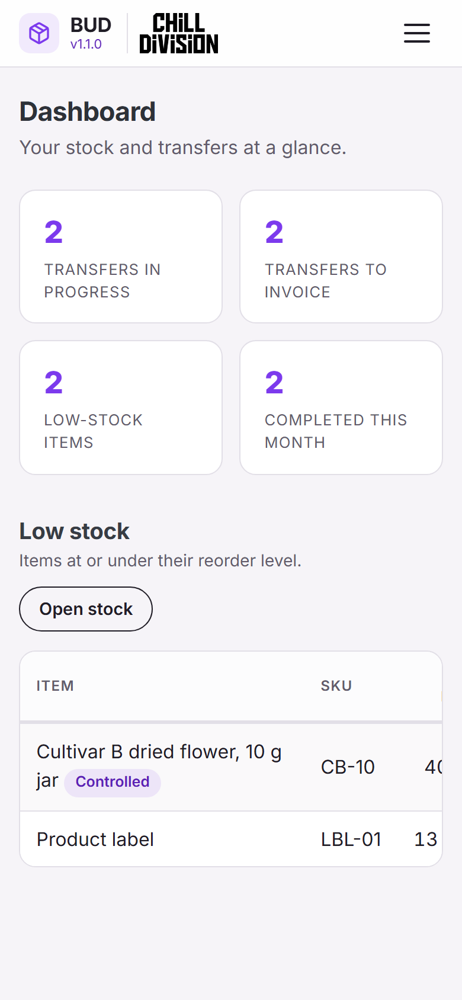

The [user guide](bud_addon/DOCS.md) walks through each page. It's also on
the app's Documentation tab in Home Assistant.

## A look around

Every screenshot here is made-up demo data.

**Chain of custody.** Start a transfer and its stock comes off. Print its
shipping manifest to go with it, and the receiver signs for it when it
arrives.

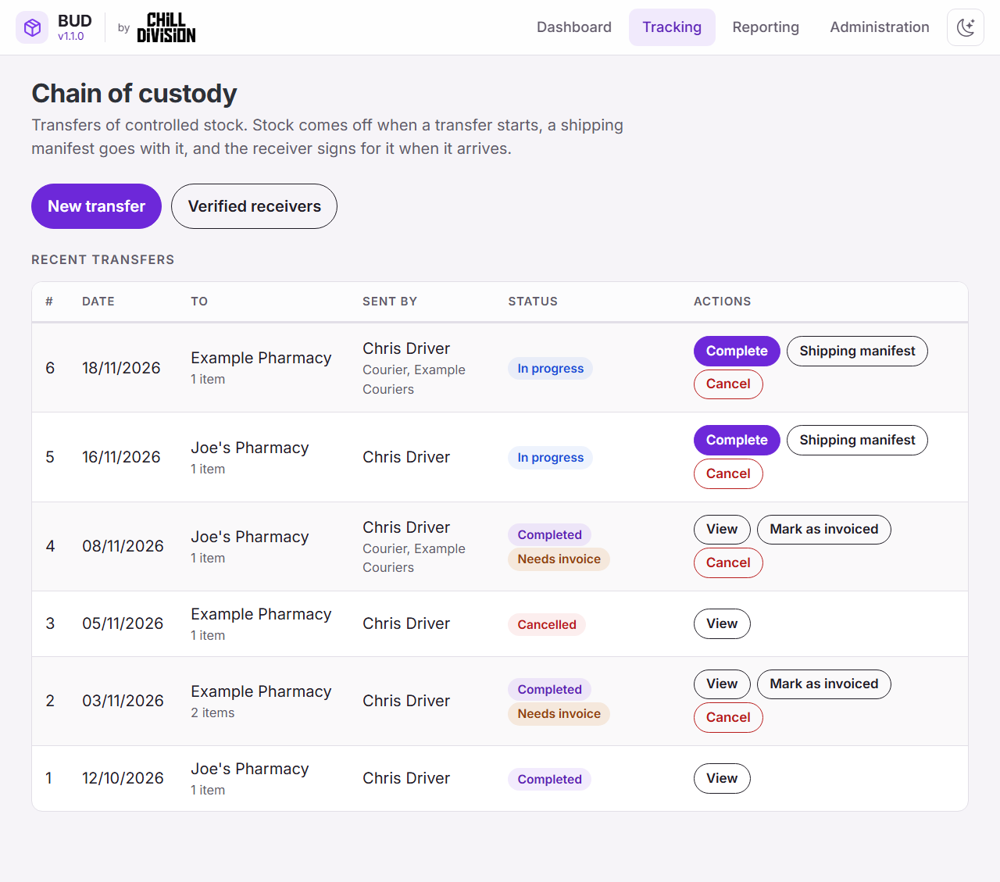

**Shipping manifests and courier deliveries.** Every transfer prints a
Universal shipping manifest, filled in from the transfer. For a courier
delivery, the receiver signs the manifest and sends back a photo or scan,
and you upload it to complete the transfer.

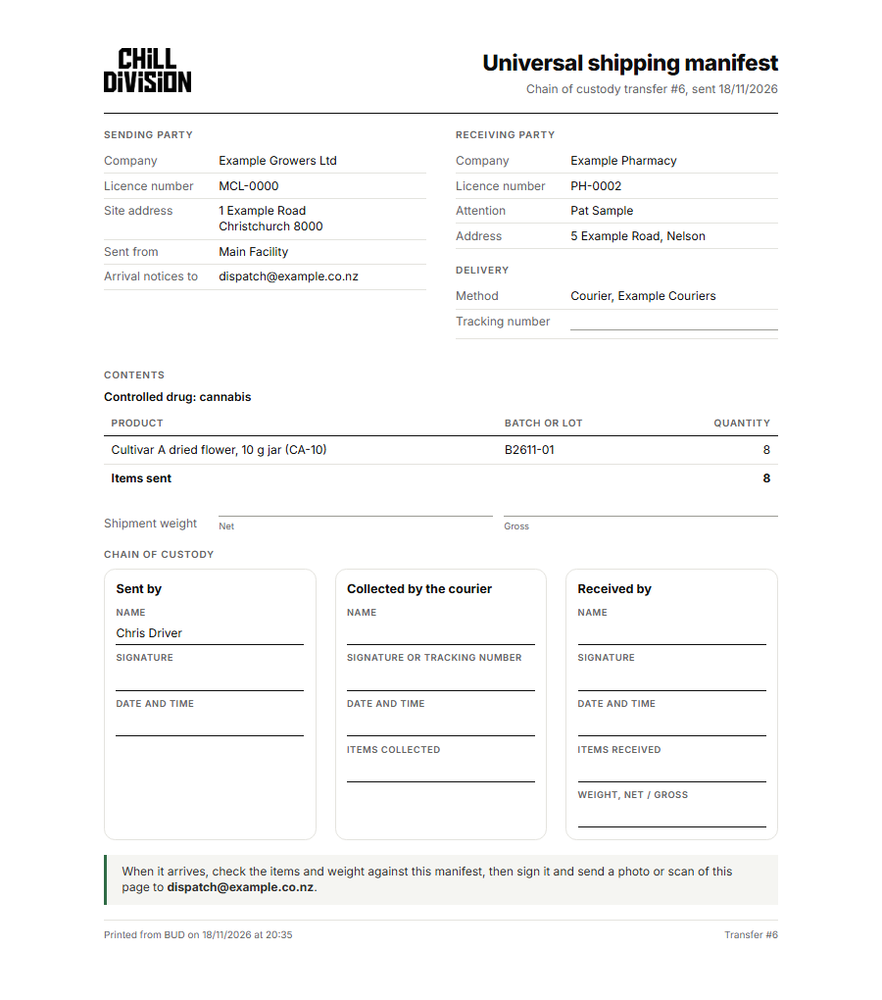 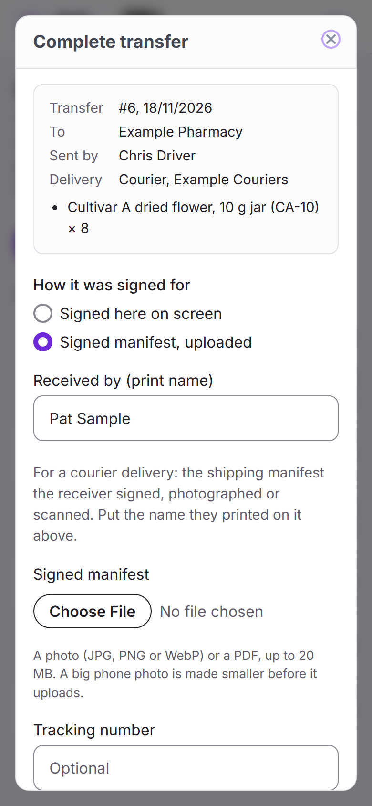

**Stock and the destruction register.** What's on hand, with low stock
flagged, and a permanent record of anything destroyed, with a witness.

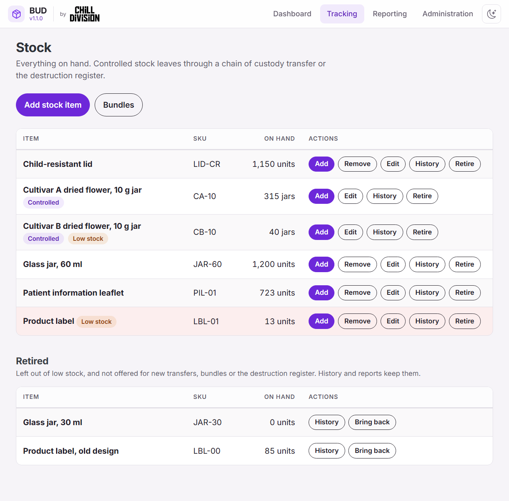 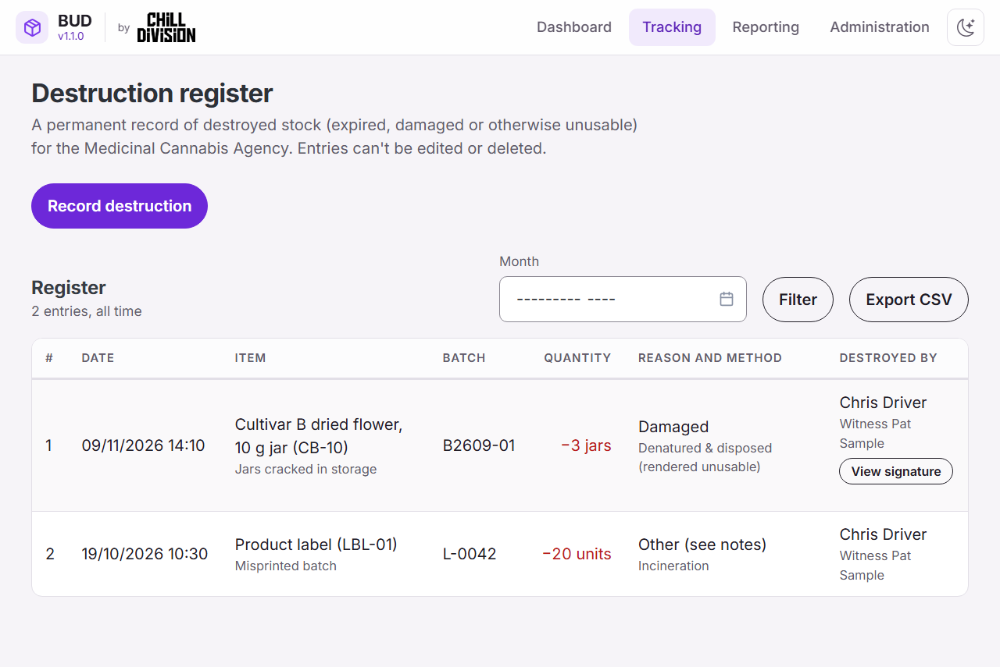

**Reporting.** Controlled stock in and out each month with the CSV for the
Agency, the Section 29 register, and who's buying what.

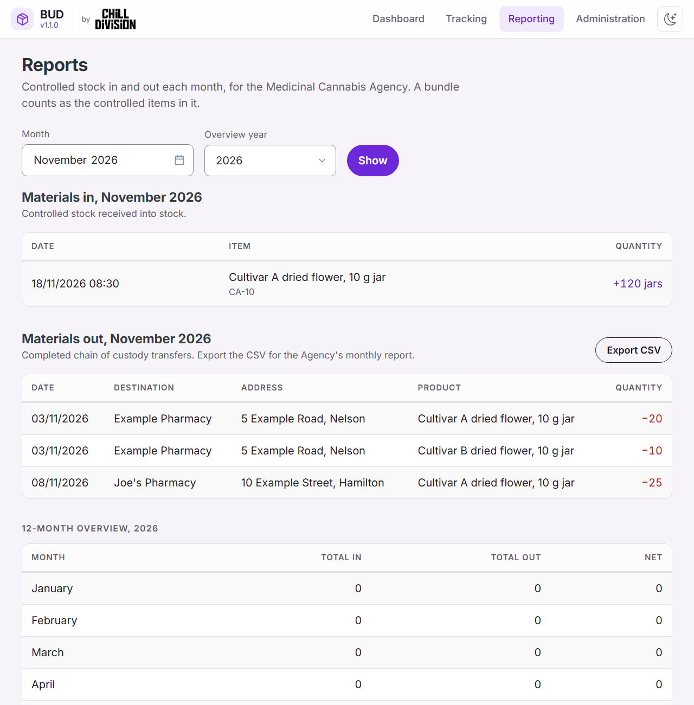 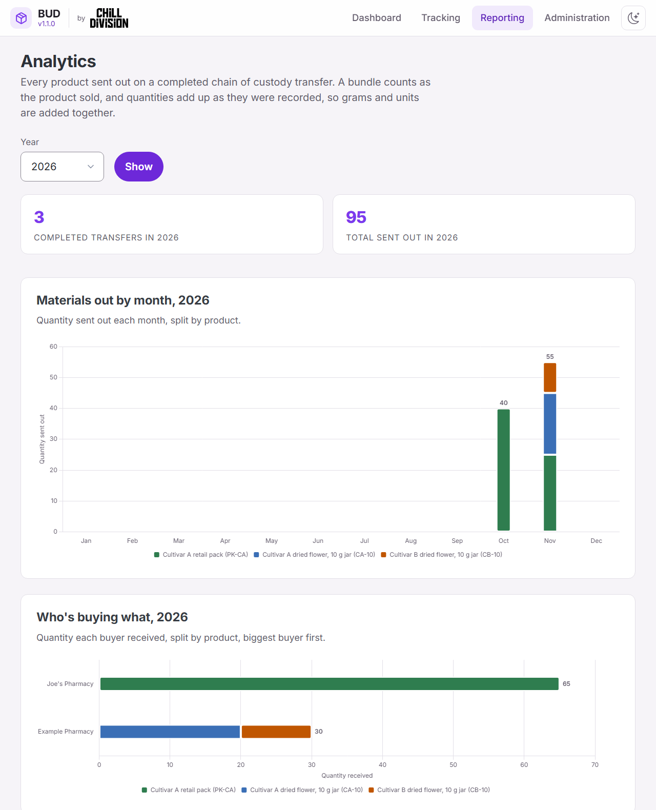

**Light or dark.** The sun and moon button switches themes, and BUD
remembers your choice on each device.

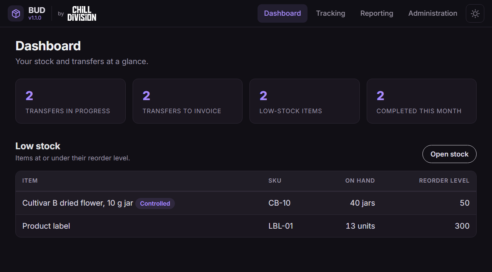 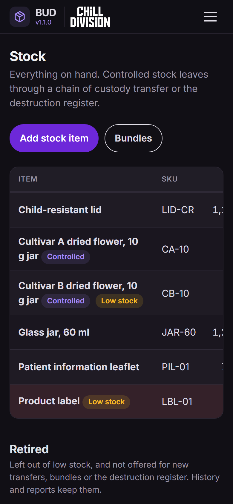

## Installation

Home Assistant has called add-ons "apps" since 2026.2, so on an older Home
Assistant read "Add-ons" wherever these steps say "Apps".

The quickest way is [this link](https://my.home-assistant.io/redirect/supervisor_add_addon_repository/?repository_url=https%3A%2F%2Fgithub.com%2FChill-Division%2Fbud_portal_repo),
which opens your Home Assistant with the BUD repository filled in, ready to
add. Or add it by hand:

1. Go to Home Assistant Settings -> Apps and open the app store.
2. Tap the 3-dot menu in the upper-right and choose "Repositories".
3. In the "Add" box, enter the URL of this repository:
   https://github.com/Chill-Division/bud_portal_repo
4. Click "Add", then "Close". You may need to choose "Check for updates" from
   the same menu.
5. Tap the new BUD Portal app, select "Install", turn on "Show in sidebar",
   then tap "Start".

## Your data and backups

Everything BUD records is stored in one SQLite database in the app's own
storage (`/data/bud.db`), so it survives updates and is included in your Home
Assistant backups. Make sure automatic backups are turned on and copied
somewhere off the box.

## For developers

The rules every change must follow, for people and AI assistants alike, are
in [AGENTS.md](AGENTS.md). [TESTING.md](TESTING.md) covers the test suite,
running BUD locally with demo data, and retaking these screenshots.

### How it's built

* PHP 8.3 and nginx in the app image, SQLite at `/data/bud.db`.
* No build step. Pico CSS, the Inter font and Chart.js are served by the app
  itself (`css/vendor/`, `fonts/inter/`, `js/vendor/`), so BUD works on a Home
  Assistant box with no internet.
* `css/bud.css` is BUD's look on top of Pico: GRACe's layout, the Chill
  Division brand's buttons and type, and BUD's violet.
* Every page starts with `includes/header.php` (the app bar and menu) and ends
  with `includes/footer.php`. Shared helpers are in `includes/` and
  `js/bud.js`.
* `config.php` upgrades the database on every request (see AGENTS.md).

### Database locked (SQLSTATE[HY000]: General error: 6)

A "database table is locked" error during an upgrade is almost always an
**open PDO cursor** on the same connection. Checking for a table or column
with a `SELECT` keeps a read cursor open, and SQLite then blocks an
`ALTER TABLE` or `DROP TABLE` on that connection to prevent corruption. Close
the cursor first with `$stmt = null;`, or read the results with
`fetchAll()` before writing.
